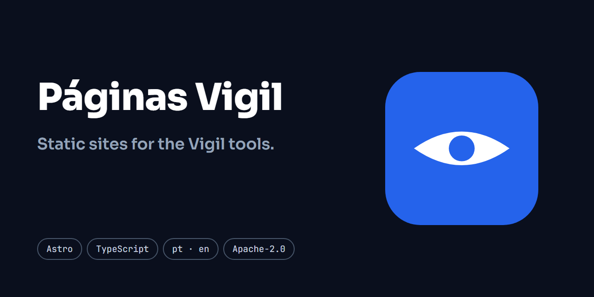

# Páginas Vigil

[Português (Brasil)](README.md) · **English**




[](https://github.com/ryanvmorais/paginas-vigil/actions/workflows/ci.yml)


**This repository holds the static websites, built with Astro, that present open-source tools.** Each tool has its own site, in `apps/<tool>`, published on its own subdomain:

- **[WebVigil](https://github.com/ryanvmorais/webvigil)**: a web vulnerability scanner. The site is at [webvigil.ryanmorais.com.br](https://webvigil.ryanmorais.com.br).
- **[MailVigil](https://github.com/ryanvmorais/mailvigil)**: a DMARC report analyzer that tells you whether your domain is ready for `p=reject`. The site is at [mailvigil.ryanmorais.com.br](https://mailvigil.ryanmorais.com.br).

Every site exists in Portuguese and in English: the Portuguese text lives at the root and the English text under `/en/`. The pages are static HTML generated by Astro, with no UI framework and no server. The repository has a single name, not the name of one tool, because it serves all the sites.

> **Status:** live. Each site is served by Cloudflare Workers Static Assets, one project per subdomain, and is published on every merge to `main` with a green CI.

## What is in here

- **`apps/webvigil`** and **`apps/mailvigil`**: one site per tool.
- **`packages/tema`**: the theme the sites share: fonts, styles, the bilingual layout, interface blocks and the check that every text exists in both languages.
- **`scripts/`**: the check of the generated HTML, the Content Security Policy (CSP) and the hosting files (`_headers`, `robots.txt`, `sitemap.xml`), all generated in each site's build; and the check of what is live, run by the deploy.
- **`.github/workflows/`**: the CI, the security analyses, Lighthouse and the deploy.
- **`specs/`**: the specification of each feature, in [specs/](specs/README.md) (in Portuguese).

## Decisions worth knowing

- **Bilingual, with no automatic redirect.** `/` in Portuguese and `/en/` in English, with real links between the two versions and `x-default` pointing to `/en/`; the browser language decides nothing. Origin: [`002-tema`](specs/002-tema/).
- **No inline script or style.** The deploy's Content Security Policy does not allow `unsafe-inline`, so every script and every style goes in an external file. Origin: [`001-fundacao`](specs/001-fundacao/).
- **Measurement only with consent.** Google Analytics 4 runs in Consent Mode, denied by default, and `gtag.js` is only loaded after the visitor accepts. Origin: [`003-medicao`](specs/003-medicao/).
- **Headers and discovery files generated in the build.** The `_headers` (with the CSP, HSTS and the other headers), `robots.txt` and `sitemap.xml` come out of each site's build, never written by hand, and the deploy checks that the live domain serves them as the build generated them. Origin: [`006-hospedagem`](specs/006-hospedagem/).

## Development

Prerequisites: [Node](https://nodejs.org/) 26 or newer and [pnpm](https://pnpm.io/) 12.

```bash
# Install the dependencies
pnpm install

# Enable the pre-commit hook (once per clone)
git config core.hooksPath .githooks

# Run a site in development mode (swap in the site you want)
pnpm --filter webvigil dev
pnpm --filter mailvigil dev
```

Audience measurement (Google Analytics 4 with consent) is off by default. To turn it on, copy `.env.example` to `.env` and fill in `PUBLIC_GA_MEASUREMENT_ID`: without it the page has no measurement, no cookie banner and no "Manage Cookies" control.

The quality gate, the same one CI and the pre-commit hook run:

```bash
# Check formatting
pnpm format:check

# Lint
pnpm lint

# Type check
pnpm typecheck

# Tests
pnpm test

# Static build of each site
pnpm build

# Fix formatting, when the check fails
pnpm format
```

Each site's build ends by checking the generated HTML (`scripts/verificar-dist.mjs`) and fails if it finds a `<script>` without `src`, a `<style>` or `style=`, an anchor that points to nothing, or a resource outside the Content Security Policy.

To see what the visitor will see, build a site and serve the build (with `.env` filled in, the page comes out with measurement and the banner):

```bash
# Swap webvigil for the site you want
pnpm --filter webvigil build
pnpm --filter webvigil preview
```

The map of every technology in the stack, with the reason behind each choice, is in [docs/stack.md](docs/stack.md) (in Portuguese). The third-party material (an icon and the fonts) is listed in [NOTICE](NOTICE). To contribute, see [CONTRIBUTING.md](CONTRIBUTING.md) (in Portuguese). To report a security problem, see [SECURITY.md](SECURITY.md) (in Portuguese).

## License

[Apache-2.0](LICENSE).
