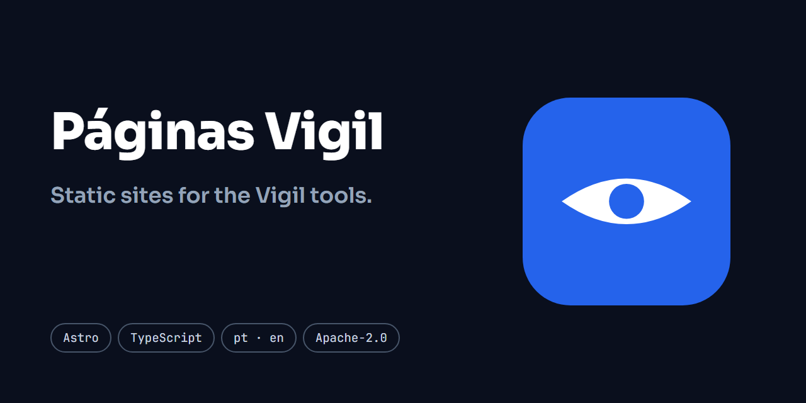

# Páginas Vigil

**Português (Brasil)** · [English](README.en.md)




[](https://github.com/ryanvmorais/paginas-vigil/actions/workflows/ci.yml)


**Este repositório guarda os sites estáticos, feitos em Astro, que apresentam ferramentas de código aberto.** Cada ferramenta tem o próprio site, em `apps/<ferramenta>`, publicado no próprio subdomínio:

- **[WebVigil](https://github.com/ryanvmorais/webvigil)**: scanner de vulnerabilidades web. O site está em [webvigil.ryanmorais.com.br](https://webvigil.ryanmorais.com.br).
- **[MailVigil](https://github.com/ryanvmorais/mailvigil)**: analisador de relatórios DMARC que diz se o domínio já está pronto para `p=reject`. O site está em [mailvigil.ryanmorais.com.br](https://mailvigil.ryanmorais.com.br).

Cada site existe em português e em inglês: o texto em português fica na raiz e o em inglês em `/en/`. As páginas são HTML estático gerado pelo Astro, sem framework de interface e sem servidor. O repositório tem um nome só, e não o de uma ferramenta, porque serve todos os sites.

> **Status:** no ar. Cada site é servido pelo Cloudflare Workers Static Assets, num projeto por subdomínio, e é publicado a cada merge na `main` com o CI verde.

## O que tem aqui

- **`apps/webvigil`** e **`apps/mailvigil`**: um site por ferramenta.
- **`packages/tema`**: o tema que os sites compartilham: fontes, estilos, layout bilíngue, blocos de interface e a conferência de que todo texto existe nos dois idiomas.
- **`scripts/`**: a conferência do HTML gerado, a política de segurança de conteúdo (CSP) e os arquivos de hospedagem (`_headers`, `robots.txt`, `sitemap.xml`), gerados no build de cada site; e a conferência do que está no ar, rodada pelo deploy.
- **`.github/workflows/`**: o CI, as análises de segurança, o Lighthouse e o deploy.
- **`specs/`**: a especificação de cada funcionalidade, em [specs/](specs/README.md).

## Decisões que valem saber

- **Bilíngue, sem redirecionamento automático.** `/` em português e `/en/` em inglês, com links reais entre as duas versões e `x-default` apontando para `/en/`; o idioma do navegador não decide nada. Origem: [`002-tema`](specs/002-tema/).
- **Nenhum script nem estilo inline.** A política de segurança de conteúdo do deploy não permite `unsafe-inline`, então todo script e todo estilo vão em arquivo externo. Origem: [`001-fundacao`](specs/001-fundacao/).
- **Medição só com consentimento.** O Google Analytics 4 roda em Consent Mode, negado por padrão, e o `gtag.js` só é carregado depois do aceite. Origem: [`003-medicao`](specs/003-medicao/).
- **Cabeçalhos e descoberta gerados no build.** O `_headers` (com a CSP, o HSTS e os demais cabeçalhos), o `robots.txt` e o `sitemap.xml` saem do build de cada site, nunca escritos à mão, e o deploy confere que o domínio no ar os serve como o build os gerou. Origem: [`006-hospedagem`](specs/006-hospedagem/).

## Desenvolvimento

Pré-requisitos: [Node](https://nodejs.org/) 26 ou mais novo e [pnpm](https://pnpm.io/pt/) 12.

```bash
# Instale as dependências
pnpm install

# Ative o hook de pre-commit (uma vez por clone)
git config core.hooksPath .githooks

# Rode um site em modo de desenvolvimento (troque pelo site que quiser)
pnpm --filter webvigil dev
pnpm --filter mailvigil dev
```

A medição de audiência (Google Analytics 4 com consentimento) fica desligada por padrão. Para ligá-la, copie `.env.example` para `.env` e preencha `PUBLIC_GA_MEASUREMENT_ID`: sem ele a página não tem medição, banner de cookies nem o controle "Gerenciar Cookies".

O portão de qualidade, o mesmo do CI e do pre-commit:

```bash
# Confere a formatação
pnpm format:check

# Lint
pnpm lint

# Checagem de tipos
pnpm typecheck

# Testes
pnpm test

# Build estático de cada site
pnpm build

# Corrige a formatação, quando a conferência falhar
pnpm format
```

O build de cada site termina conferindo o HTML gerado (`scripts/verificar-dist.mjs`) e falha se achar `<script>` sem `src`, `<style>` ou `style=`, âncora que aponta para nada ou recurso fora da política de segurança de conteúdo.

Para ver o que o visitante verá, construa um site e sirva o build (com o `.env` preenchido, a página sai com medição e banner):

```bash
# Troque webvigil pelo site que quiser
pnpm --filter webvigil build
pnpm --filter webvigil preview
```

O mapa de cada tecnologia da stack, com o porquê de cada escolha, está em [docs/stack.md](docs/stack.md). O material de terceiros (um ícone e as fontes) está listado no [NOTICE](NOTICE). Para contribuir, veja o [CONTRIBUTING.md](CONTRIBUTING.md). Para relatar um problema de segurança, veja o [SECURITY.md](SECURITY.md).

## Licença

[Apache-2.0](LICENSE).
